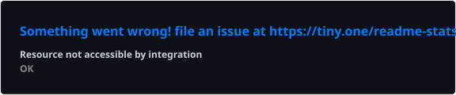

<h1 align="center">Olá, eu sou o Matheus 👋</h1>

  

  
  
  

---

### 🧠 Sobre mim

Sou **Desenvolvedor Full Stack** em Luanda, Angola, com mais de 3 anos a construir produtos web completos: do design no Figma à API, à base de dados e ao deploy. Desde 2023 trabalho na **ClubMed Saúde**, uma plataforma de telemedicina, como Full Stack Developer e UI Designer.

Tenho experiência em produtos com utilizadores reais, onde visão de produto conta tanto quanto o código. Liderei equipas e a infraestrutura de uma plataforma de cursos com **mais de 30 mil utilizadores**, onde reduzi o tempo de carregamento de **14s para 0.5s**. Antes disso, trabalhei como freelancer para clientes no **Brasil, Japão e Angola**.

Trabalho com **React, Next.js, Angular, TypeScript, NestJS, Express, Laravel, Prisma, PostgreSQL, MySQL, MongoDB e Firebase**. Na infraestrutura, gerencio servidores **Linux/VPS** com **Docker, Cloudflare e CI/CD no GitHub Actions**, mantendo ambientes estáveis e deploys automatizados.

O que mais gosto de fazer é pegar num problema de negócio e entregar um produto rápido, bem desenhado e fácil de manter. Também já criei conteúdo sobre programação web no [YouTube](https://www.youtube.com/c/matheusmanuel).

- 🔭 Neste momento: a aprender **OutSystems** e a construir aplicações com IA
- 💬 Fala comigo sobre: desenvolvimento web, performance, infraestrutura e carreira em tech
- 💼 Aberto a: **vagas Full Stack** (remoto ou presencial em Luanda) e **projetos freelance**
- 📫 Contacto: [hello@matheusmanuel.com](mailto:hello@matheusmanuel.com)
- 🌐 Portfolio: [matheusmanuel.com](https://matheusmanuel.com)

---

### Stack

  
   
  
   
  

---

### Projetos em destaque

| Projeto | O que é | Stack |
|---|---|---|
| [**cmd-automator**](https://github.com/matheusmanuel2/cmd-automator) | App de desktop que sobe vários projetos de uma vez, cada um com o seu terminal real (PTY). | Tauri · React · Rust |
| [**frontdex**](https://github.com/matheusmanuel2/frontdex) | 🚧 Em desenvolvimento. Em breve mais detalhes. | — |
| **Kursinha** · [kursinha.com](https://kursinha.com) | Plataforma de cursos com área de membros, checkout e painel admin. 30k+ utilizadores. | Next.js · NestJS · Docker · VPS |
| **ClubMed Saúde** | Plataforma de telemedicina: landing pages, dashboard e agendamentos. | Angular · Laravel · Figma |

> Grande parte do meu trabalho com clientes está em repositórios privados. Os detalhes de cada projeto estão em [matheusmanuel.com](https://matheusmanuel.com).

---

### Estatísticas

  
  

---

  Vamos conversar? <a href="mailto:hello@matheusmanuel.com">hello@matheusmanuel.com</a> · <a href="https://wa.me/244924203717">WhatsApp</a>

